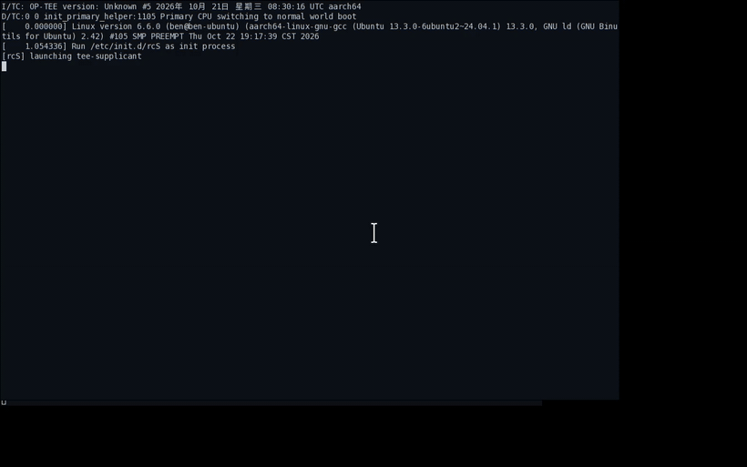

# rsee_patch

> 某厂商 TEE（OP-TEE 3.6 闭源分支）keymaster TA 的 ECDSA 签名全失败修复包。
> 静态逆向 → QEMU 复现 → 两处 2 字节 Patch → 原厂重签 → 端到端验证闭环。

---

## 背景

在 MTK ARMv8 平台（Android 9）上，业务方用**某厂商 TEE** + 自定义 keymaster TA
（UUID `b657ba17`）做 ECDSA。现象非常典型：

> **ECDSA 密钥生成（generate）成功，但后续 sign / 验签全部失败。**

该厂商 TEE 是闭源分支——TEE 内核源码未开源，连 keymaster TA 也只有二进制
（`b657ba17-b3b3-47f5-b389-6b53f30c0baf.ta`）。可行路径只剩三条：

1. **静态逆向**：反汇编 TEE 固件镜像与 TA ELF，解释行为；
2. **QEMU 复现**：把真实 TA 装进 OP-TEE 3.6 模拟环境，受控复现失败；
3. **二进制 Patch + 重签名**：改 TA 字节，用原厂私钥重签后烧录。

本仓就是第 3 条路径的完整交付物。

---

## 根因（两个原厂 bug 叠加）

### Bug 1：read_ec_key_from_keyblob 拷回密文

`read_ec_key_from_keyblob`(0x10268) 里，`DecryptKeyBlob` 把 sm4 明文写到栈缓冲，
但函数末尾 `TEE_MemMove(输出, __dest, enc_len)` 拷的是**原始密文**，不是明文。

→ EC 私钥 keyblob 读出来仍是密文，喂给 OpenSSL `d2i_ECPrivateKey` 必然失败。

（RSA 侧 `read_rsa_key_from_keyblob` 拷贝明文栈缓冲，所以 RSA 一直正常——这也是为什么
"RSA 好、EC 坏"。）

### Bug 2：SPKI 覆盖导致 SEC1 解析失败（读侧绕过，写侧根因未定论）

修复 1 之后 sign 仍失败，错误链前移到 `ecp_oct.c:355`。QEMU gdb 断
`EC_POINT_oct2point` 看到：SEC1 私钥数据里 `[1] pubkey` 的 **Y 坐标后 8 字节被损坏**
（`7a9d4aeb...`），但同一 keyblob 明文区 SPKI 里的 Y 完全正确（`c9ce06cd...`）。

写侧为什么损坏**尚未定论**。曾怀疑 `EC_generate_key` 里两次 `i2d_PrivateKey` +
两次 `i2d_PUBKEY` 共用缓冲导致 SPKI 覆盖私钥区，但实验证伪了这条：把两次
`i2d_PUBKEY` 的 `pp` 改传 NULL（SPKI 变全 0），错误链完全不变。

准确的表述是：**现象已钉死（私钥区 SEC1 的尾部被覆盖损坏），机理待查。**
本包采用读侧绕过。

---

## 修复：两处 2 字节 Patch

整个修复只动了 **4 个字节**，分布在两个位置：

```text
位置        原始字节      修复后字节     指令含义变化
─────────────────────────────────────────────────────────────────────
0x1033e    49 46    →    21 46      mov r1, r9 (密文)   →  mov r1, r4 (明文栈缓冲)
0x6f42c    88 b1    →    00 b1      cbz r0, <报错分支>   →  cbz r0, <跳过坏 pubkey>
```

- `0x88 b1` / `0x00 b1` 都是 Thumb `cbz r0, <imm8>` 编码，**只有低字节的分支偏移变了**；
- `0x49 46` / `0x21 46` 都是 `mov r1, rN` 的寄存器形式，**只有源寄存器编号变了**。

两处都不涉及指令长度变化，不需要重排代码。

> **PATCH-C 是绕过，不是修复。** 覆盖依然存在，只是读侧不再因此失败。代价是
> `EC_KEY` 里**没有公钥**：`export_key` 路径因此不适用（报 `blob_2_instance error`）。

### 为什么「改字节」必须配「重签」

只改字节没重算 digest + 重签名，secure world 验签直接拒绝 → OpenSession `ffff000f`。

debug 固件内嵌**两把** TA 验签公钥：

- **key1** = `ta_private_key.pem` 的公钥（debug key）——原厂 factory TA 由 key2（OEM key）签发；
- **key2** = 另一把 OEM key。

debug 固件**同时信任 key1 和 key2**，所以用 key1（debug key）重签就能通过。

---

## 目录结构

```text
rsee_patch/
├── README.md              # 本文件
├── docs/                  # 逆向与调试全过程记录（6 篇）
├── patches/               # 11 个 patch_*.py + apply/rollback 脚本
├── ta/                    # 重签后的修复 TA（核心交付物）
├── gif/                   # QEMU 启动 → ECDSA 验签通过 的录屏脚本
└── skill/                 # 可安装到 ~/.codex/skills 的操作手册
```

| 路径 | 内容 |
|---|---|
| `docs/tee-ecdsa-debug-fix-test-SUMMARY.md` | **总纲**：完整操作手册（复现→逆向→修复→验证） |
| `docs/tee-ecdsa-qemu-debug.md` | QEMU 调试全记录（96KB，含每层证据链的原始输出） |
| `docs/tee-ecdsa-rootcause-fix.md` | 根因分析：两处 Patch 的反汇编依据 |
| `docs/ta-b657ba17-protocol.md` | b657 TA 协议逆向（cmd 分发表） |
| `docs/tee-b657-open-session-rootcause.md` | OpenSession `ffff000f` 的成因（重签问题） |
| `docs/qemu-tee-linkB-breakthrough.md` | QEMU 启动链打通的关键突破点 |
| `patches/patch_b657_pubkey_recover.py` | **PATCH-C 脚本**（0x6f42c 改分支目标） |
| `patches/patch_b657_ec_keyblob_fix.py` | **fix1 脚本**（0x1033e 改源寄存器） |
| `patches/paths.py` | 统一的工程路径解析（`WORKSPACE` / `SEC_MODULES` / `RESIGN_TOOL_DIR`） |
| `patches/apply_ecdsa_rootcause_fix.sh` | 一键应用 fix8（校验 sha256 + 两处落位断言） |
| `patches/rollback.sh` / `restore_factory_ta.py` | 回滚到原厂 TA |
| `ta/b657_fix8_patched.ta` | **最终交付 TA**（fix1 + PATCH-C，已重签） |
| `gif/record_ecdsa_boot.sh` | 录「QEMU 启动 → ECDSA 验签通过」GIF |
| `skill/SKILL.md` | Codex skill 操作手册 |

---

## 快速开始

### 1. 应用补丁

```bash
cd patches
./apply_ecdsa_rootcause_fix.sh
```

脚本会校验 fix8 TA 的 sha256（`7334367d...`），并断言 `0x6f42c` 处已落位 `00 b1`。
把 `ta/b657_fix8_patched.ta` 覆盖到固件的 `sec_modules/` 与 `ta_debug/` 两处。

### 2. 单独打某一处 Patch

```bash
# fix1：read_ec_key_from_keyblob 拷明文（0x1033e: 49 46 → 21 46）
python3 patches/patch_b657_ec_keyblob_fix.py

# PATCH-C：d2i_ECPrivateKey 跳过坏 pubkey（0x6f42c: 88 b1 → 00 b1）
python3 patches/patch_b657_pubkey_recover.py --elf b657.elf --out patched.elf
```

两个脚本都是**幂等**的：已打过补丁会打印 `[skip]`，字节对不上会直接报错退出。

需要用到固件工程里的路径（TA 位置、重签私钥）时，先设 `WORKSPACE`：

```bash
export WORKSPACE=/path/to/your/android/workspace
export RESIGN_TOOL_DIR=$WORKSPACE/external/tee/tools/ta_resign_tool-release/linux
```

`patches/paths.py` 统一解析这些路径；也可用 `SEC_MODULES` / `RESIGN_TOOL_DIR`
单独覆盖。路径解析全部集中在 `paths.py` 一处，改工程布局只改这一个文件。

### 3. 重签名

改完字节必须重签，否则 OpenSession 直接 `ffff000f`：

```bash
python3 resign_ta.py --key ta_private_key.pem --in patched.ta
```

`resign_ta.py` 来自 TEE 官方发布工具目录（RSA PKCS1_SHA256）。

### 4. QEMU 端到端验证

```bash
qemu-tee/work/run-auto.sh 75          # 一键起（可加 gdb 参数进调试）
qemu-tee/work/test-b657-final.sh     # 端到端验证
```

成功标志：

```
[8.953] ECDSA SIGN OK
  [9.091] ECDSA VERIFY OK
```

---

## 验证结果

| 项 | 结果 |
|---|---|
| QEMU: OpenSession / EC keygen / ECDSA sign | ✅ PASS |
| QEMU: ECDSA verify (purpose=3) | ✅ PASS（`Ecdsa_Verify_Finish 494 result=1`） |
| 真机: boot 稳定、RSA/AES/HMAC 回归 | ✅ PASS |
| 真机: ECDSA sign+verify（3 曲线 × 5 摘要 = 15 组） | ✅ 全部 `tee=true` PASS |
| `export_key`（EC 导出公钥） | ⚠️ 已知边界：PATCH-C 后 EC_KEY 无公钥，报 `blob_2_instance error` |

真机 ECDSA 实测输出（节选）：

```
PASS ECDSA secp256r1 SHA-1   sign+verify - sig=72B  DER=true tee=true
PASS ECDSA secp256r1 SHA-256 sign+verify - sig=72B  DER=true tee=true
PASS ECDSA secp384r1 SHA-256 sign+verify - sig=103B DER=true tee=true
PASS ECDSA secp521r1 SHA-512 sign+verify - sig=104B DER=true tee=true
```

`tee=true` 表示签名走 TEE 而非软件回退。

---

## 演示动图

`gif/` 下的脚本可复现下面这段「QEMU 启动 → ECDSA 验签通过」的录屏：



录制方式：Xvfb 虚拟显示 → xterm 跟随实时过滤后的串口日志 → ffmpeg `x11grab` 录屏
→ `palettegen` / `paletteuse` 压成 GIF。

---

## 边界与免责

- 本仓只含**重签后的修复 TA**（最终交付物），不含原厂 TA 变体。
- 本仓**不含任何私钥**。`ta_private_key.pem` 属原厂发布工具链，未纳入版本管理。
- 文中所有厂商名、平台代号、产品代号均已匿名化；保留 `MTK` / `Android` / `OP-TEE` /
  `b657ba17` 等技术术语以便复现。
- 仅供已授权设备上的调试与研究使用。
